# A RECAP value function for robot rollouts: what we built and what we saw

This page presents the work on DreamMachines' actuator-unboxing rollouts, as of 2026-10-12. It covers:
- the pipeline and the reward design;
- the baseline value function at different training checkpoints;
- two variants we tried (frozen backbones, a smaller failure penalty);
- the proposed next step: cross-fitting, then a single critic;
- the DAgger dataset with human interventions: reward shaping with a penalty before each takeover (§10).

Specs and code-level details live in [README.md](README.md) and [docs/](docs/).

**Contents**
1. [The goal](#1-the-goal)
2. [The pipeline](#2-the-pipeline)
3. [Reward shaping and value targets](#3-reward-shaping-and-value-targets)
4. [Model and training](#4-model-and-training)
5. [The baseline at different checkpoints](#5-the-baseline-at-different-checkpoints)
6. [Other things we tried](#6-other-things-we-tried)
7. [What none of these critics can fix](#7-what-none-of-these-critics-can-fix)
8. [Next step: K-fold cross-fitting, then a single critic](#8-next-step-k-fold-cross-fitting-then-a-single-critic)
9. [Status, data asks and reproduction](#9-status-data-asks-and-reproduction)
10. [Human interventions: the DAgger dataset](#10-human-interventions-the-dagger-dataset)

---

## 1. The goal

[RECAP](https://arxiv.org/abs/2511.14759) (π\*0.6, Physical Intelligence) improves a robot policy from its own
rollouts. It does not use online RL; it relies on a per-frame label saying *"was what the robot did here better than
usual?"*. The policy is then trained conditioned on that label, and at test time it is always asked for the "better"
behaviour.

**Our job is to produce those labels** for every frame of
[`DreamMachines/20h_fullft_eval_success`](https://huggingface.co/datasets/DreamMachines/20h_fullft_eval_success).
We do not train the policy itself.

| Dataset | |
|---|---|
| Task | Bimanual. The left arm takes an actuator from a box and hands it to the right arm, which places it in a tray. |
| Episodes | 800 evaluation rollouts of a fine-tuned policy: 423 successes and 377 failures |
| Frames | 634 838 at 50 fps (~3.5 h). 3 cameras (top, left wrist, right wrist) at 224 px, plus a 14-D joint state |
| Episode length | successes: median 11.7 s · failures: median 15 s, up to 44.6 s |

## 2. The pipeline

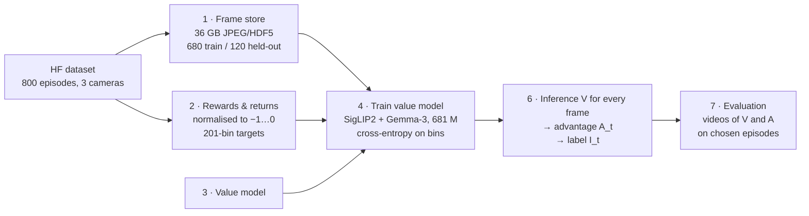

| Step | What it does | Key facts |
|---|---|---|
| 1 Data | Decodes the three mp4 streams into one HDF5 file per episode, builds frame/episode tables and stratified splits | Every camera is frame-exact for all 800 episodes. Loader runs at 10 k frames/s with 16 workers. Splits: 680 train / 120 held-out (stratified by outcome × length), plus 5 folds |
| 2 Returns | Reward → return-to-go → normalised value target → bin index (§3) | Three failure penalties prepared: 2229 (default), 1115, 4458 |
| 3 Model | Vision-language value model (§4) | Overfits 16 samples to a loss of 0.0003, as a sanity check |
| 4 Training | Training loop with evaluation on held-out and on training episodes, early stopping, V-curve plots | One RTX 5090, ~2.6 h per run |
| 6 Labelling | Value inference → N-step advantage → dataset-wide threshold → `I_t` | ~4 s for all 634 838 frames once values exist. Degenerate-label detection (see §9) |
| 7 Evaluation | Renders the cameras with V(t) and A(t) under them, with a moving cursor | All the clips on this page |

98 unit tests pass on CPU (`uv run pytest -q`, ~16 s).

## 3. Reward shaping and value targets

### 3.1 Reward and return

We follow the paper exactly. Every frame costs −1. The last frame of a success gets 0, and the last frame of a
failure gets a large penalty −C_fail. The value target is the undiscounted return-to-go, divided by one
dataset-wide constant `Z` so that it lies in [−1, 0]:

```
r_t = −1  (every frame)          r_last = 0 (success)  or  −C_fail (failure)
G_t = −(frames left) − C_fail·[failure]          g_t = G_t / Z ∈ [−1, 0]
Z   = |most negative return in the dataset| = (2229 − 1) + C_fail      (the longest episode, 2229 frames, is a failure)
```

So **V(o_t) ≈ −(expected time to finish, plus the failure penalty weighted by the chance of failing)**. Examples with
the default `C_fail = 2229` (`Z = 4457`):

| Situation | g |
|---|---|
| Last frame of a success | 0 |
| Start of a median success (586 frames) | −0.13 |
| Start of the slowest success (2077 frames) | −0.47 |
| Last frame of a failure | −0.50 |
| Start of a median failure (749 frames) | −0.67 |
| Start of the longest failure | −1.00 |

Within one episode, the target is a **straight line** that rises by 1/Z per frame (0.011 per second) towards 0 or
−0.5. This matters for everything below: the target has **no step at the moment of the mistake**. The network can
only learn *where* things go wrong by noticing that similar-looking states lead to different outcomes across
episodes.

<p align="center">
  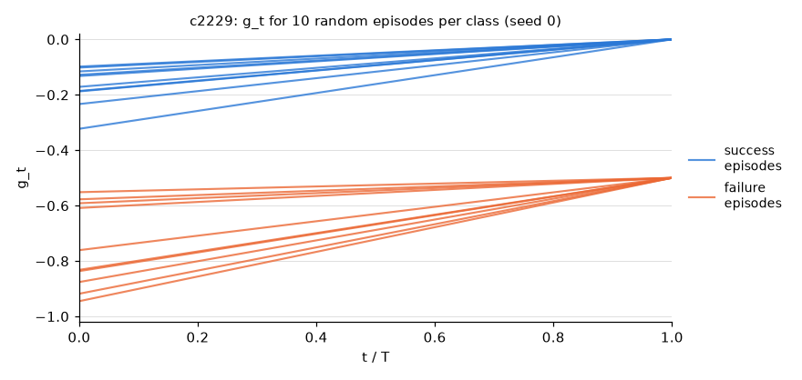
  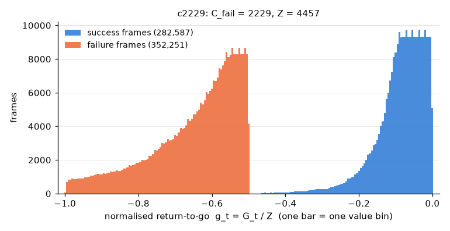
</p>

*Left: targets of 10 successes (blue) and 10 failures (orange) are straight lines ending at 0 and −0.5. Right: all
634 838 frame targets. Success and failure frames never overlap.*

### 3.2 Choosing the failure penalty

The paper only says C_fail is "a large constant chosen so as to ensure that failed episodes have low values". We set
**C_fail = 2229, the longest episode length**. Any value above 2076 (the slowest success) keeps every failure frame
below every success frame. T_max is a simple rule that leaves a small empty gap at −0.47…−0.50.

We also prepared a smaller (1115) and a larger (4458) penalty. With **C_fail = 1115**, the two ranges overlap: the
start of a slow success scores lower than the end of a short failure. Speed then weighs more relative to the outcome
(tested in §6.2).

### 3.3 Distributional head

As in the paper, V is not regressed directly. The range [−1, 0] is cut into **201 bins**, and the model predicts a
probability over bins, trained with cross-entropy against the target's bin. V is the expectation over the bins.
This lets the model say "50 % this ends in ~3 s, 50 % this fails", rather than averaging the two into a value that
corresponds to neither.

### 3.4 From values to labels

```
A_t = (reward over the next N frames) + V(o_{t+N}) − V(o_t)      N = 50 frames = 1 s   (paper, post-training)
I_t = A_t ≥ ε,   with ε chosen so that 40 % of all frames are positive                (paper: ~40 % for rollouts)
```

The reward term over one second is −50/Z = −0.011, so with a perfect V a success that progresses at the usual pace
gets A ≈ 0. A > 0 means the next second went better than expected: faster progress, or a risk resolved in our
favour (e.g. a grasp that holds). A < 0 means it went worse: a stall, a fumble, or a mistake that makes failure
likely.

## 4. Model and training

| | Choice | Source |
|---|---|---|
| Backbone | SigLIP2-so400m (vision, 412 M) + Gemma-3-270M (language, 268 M) = 681 M parameters, fully fine-tuned | Paper: "670M VLM initialised from Gemma 3". Same pair as RLinf's open RECAP |
| Inputs | 3 camera images (3 × 256 tokens) + task prompt + 14-D joint state, then a learned CLS token → 201 logits | Paper: same inputs as the policy |
| Optimiser | AdamW, lr 5e-5 (backbones) / 1e-4 (new layers), 200-step warm-up then constant, batch 256 | RLinf |
| Budget | at most one pass over the training frames (2 100 steps). Evaluate every 250 steps; stop after 3 evaluations without improvement on held-out cross-entropy | Own choice: RLinf's 8 000 steps would take ~18 h here |
| Not used | augmentation, web-data co-training (paper), re-weighting | Kept to the plain recipe |
| Hardware | 1 × RTX 5090, bf16, 31 samples/s, 13.7 GiB | |

Every 250 steps the model is evaluated on two sets of 120 episodes, every 10th frame:
- **held-out**: episodes it never trains on;
- **val_train**: 120 of its own training episodes.

The gap between the two measures memorisation.

## 5. The baseline at different checkpoints

Run `vf_c2229_s0` (C_fail = 2229) early-stopped at step 1000, after 2.6 h. Its best held-out cross-entropy was at
step 250.

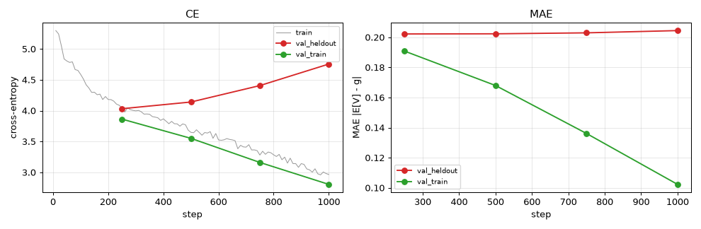

| step | held-out CE | val_train CE | held-out MAE | val_train MAE | held-out rank corr. with g |
|---:|---:|---:|---:|---:|---:|
| **250** | **4.03** | 3.86 | 0.20 | 0.19 | **0.58** |
| 500 | 4.14 | 3.55 | 0.20 | 0.17 | 0.57 |
| 750 | 4.41 | 3.16 | 0.20 | 0.14 | 0.53 |
| 1000 | 4.76 | 2.81 | 0.20 | 0.10 | 0.49 |

From step 250 on, the error on training episodes keeps falling while held-out error does not improve: the extra fit
does not generalise. Held-out cross-entropy cannot get close to 0 anyway:
early in an episode, nobody can know whether it will fail.

### 5.1 What V looks like: a hidden mistake inside a success (held-out episode 771)

At ~6.5–8 s the policy makes a bad move and then recovers; the episode still succeeds. A good critic should dip
there and come back.

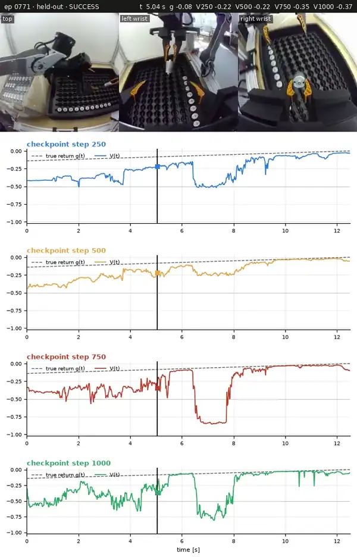

*Clip of 5–10.5 s. Under the cameras: V(t) (solid) and the true return (dashed) for each checkpoint. Full video:
[ckpt_ep0771.mp4](reports/figures/results/videos/ckpt_ep0771.mp4).*

- **Step 250** dips to −0.5 at the bad move, then climbs back: the behaviour we want.
- **Step 500** barely reacts (−0.25). It is smoother, but it misses the mistake.
- **Steps 750 and 1000** crash to −0.85 / −0.8, the failure level. They are overconfident: the move was bad, but the
  episode recovered.

### 5.2 A failure with one visible mistake (held-out episode 750)

At ~7.5 s the actuator is taken sideways, and the episode fails.

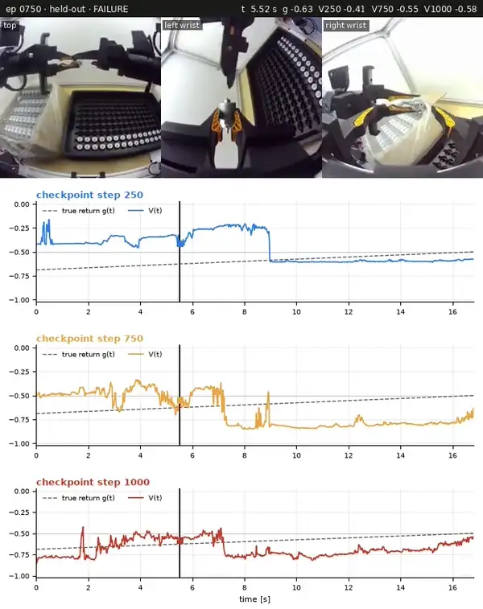

*Clip of 5.5–11.5 s. Full video: [ckpt_ep0750.mp4](reports/figures/results/videos/ckpt_ep0750.mp4). No step-500
values exist for this episode.*

- **Step 250** stays high, then drops once, at ~9 s, to the failure level. That is a clean, single drop, ~1.5 s late.
- **Step 750** drops right at the mistake (~7.2 s), but overshoots to −0.85.
- **Step 1000** already sits at **−0.8 at frame 0**. It "knows" this episode fails before anything happens, so the
  drop at the mistake no longer stands out.

### 5.3 Memorisation of training episodes

Training episodes are **85 % of the frames we must label**, so how the critic behaves on them matters most.

| signal (val_train / held-out) | step 250 | step 500 | step 750 | step 1000 |
|---|---|---|---|---|
| Success predicted from V at 25 % of the episode (AUC) | 0.55 / 0.59 | 0.53 / 0.60 | **0.72** / 0.59 | **0.89** / 0.56 |
| Error on success frames (MAE) | 0.20 / 0.20 | 0.16 / 0.17 | 0.14 / 0.19 | **0.10 / 0.20** |
| Median time at which V is sure of failure (fraction of the episode) | 0.23 / 0.24 | 0.40 / 0.45 | **0.09** / 0.18 | **0.07** / 0.19 |

From step 750, the critic recognises its training episodes and recalls how they ended. On a training failure, V is
low before the mistake. On a training success, V stays high through fumbles. Either way, the advantage inside the
episode is no longer about the robot's actions.

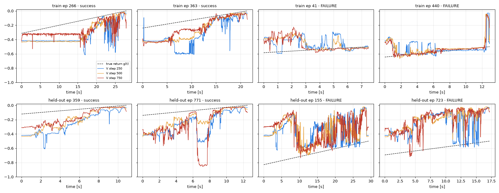

*Top row: training episodes. Bottom row: held-out episodes. Dashed: true return.*

### 5.4 Labels per checkpoint

The threshold ε is set so that 40 % of the dataset's frames are positive. It is estimated from the 240 validation
episodes (every 10th frame), with the training episodes re-weighted to their share of the dataset.

| critic | ε | positive frames in successes | positive frames in failures | gap |
|---|---:|---:|---:|---:|
| c2229 @ 250 | +0.0143 | 51 % | 28 % | 23 pts |
| c2229 @ 500 | +0.0132 | 47 % | 32 % | 15 pts |
| c2229 @ 750 | +0.0107 | 46 % | 33 % | 13 pts |
| c2229 @ 1000 | +0.0070 | 46 % | 34 % | 12 pts |

Later checkpoints make labels **less related to what happens**: the success/failure gap shrinks from 23 to 12
points. A critic that has memorised an episode predicts its return almost exactly, so A ≈ 0 plus flicker. Its labels
are then close to coin flips.

**Summary of the checkpoints.**
- Step 250 is the most honest (best held-out score) and reacts to mistakes, but it flickers in ambiguous states.
- Step 500 is the smoothest, but it reacts less. Its weights were not kept, so re-training to step 500 takes ~1.3 h.
- Steps 750 and 1000 memorise and are overconfident.

## 6. Other things we tried

### 6.1 Freezing the backbones (`vf_c2229_frozen_s0`)

**Idea.** If memorisation comes from 681 M trainable parameters, freeze SigLIP and Gemma and train only the 0.88 M
new parameters (projector, state, CLS, head). Everything else follows the baseline recipe.

| step | held-out CE | val_train CE | held-out rank corr. | AUC at 25 %, val_train / held-out |
|---:|---:|---:|---:|---:|
| 250 | 4.41 | 4.30 | 0.35 | 0.44 / 0.52 |
| 500 | 4.20 | 4.02 | 0.48 | 0.51 / 0.57 |
| 750 | **4.11** | 3.86 | 0.52 | 0.54 / 0.55 |

**Result.**
- **No memorisation**: the train and held-out signals stay together.
- **Weaker overall**: best held-out CE 4.11 vs 4.03 for the baseline at step 250.
- **On the videos** it behaves like baseline step 250: failures are detected at the same time, but the drops are
  smaller and it flickers 2–3× more.

We stopped it at step ~990. Less capacity is not the fix.

### 6.2 A smaller failure penalty (`vf_c1115_s0`, C_fail = 1115)

**Idea.** With C_fail = 2229, the outcome dominates V, and differences in speed inside successes are tiny next to
it. Halving the penalty gives progress more weight (§3.2): labels in successes should follow speed more.

**Training.**
- The memorisation pattern is the same as the baseline's: the train AUC at 25 % reaches 0.82 at step 1000, while
  held-out stays at 0.57.
- Best held-out CE is at **step 500**. Its CE is not comparable with the baseline's, because the targets differ.
- The run is still training past step 1000.

**Labels.**

| critic | ε | positive frames in successes | positive frames in failures |
|---|---:|---:|---:|
| c2229 @ 250 | +0.0143 | 51 % | 28 % |
| c2229 @ 1000 | +0.0070 | 46 % | 34 % |
| **c1115 @ 500** | +0.0148 | 49 % | 30 % |
| c1115 @ 750 | +0.0134 | 47 % | 33 % |

At the dataset level, c1115 @ 500 is close to c2229 @ 250. The differences show up episode by episode. The figures
below show one row per critic:
- **left**: V(t), solid, against the true return, dashed, each on its own C_fail scale;
- **right**: A(t), with the threshold ε dashed and the positive frames shaded green.

The clips show the cameras over the four A(t) rows.

#### Episode 750: held-out failure, one clear mistake at ~7.5 s

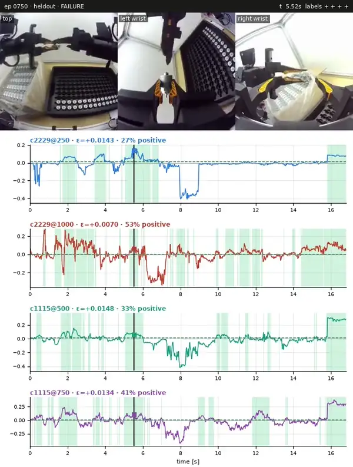

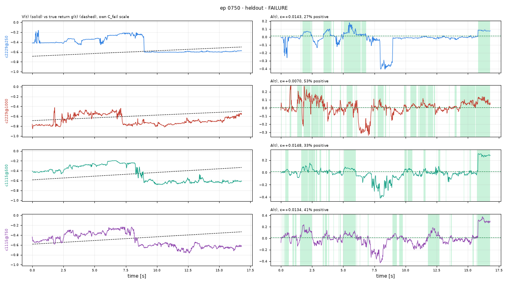

- **c1115 @ 500** stays high, then drops once around 8.5–9 s. That gives a single negative window: the mistake is
  localised, and 33 % of frames are positive. It behaves like c2229 @ 250 (27 % positive), which is good.
- **c2229 @ 1000** starts at −0.8 at frame 0 and is noisy throughout. It cannot pinpoint the mistake, and labels
  53 % of this failed episode positive.

[Full video](reports/figures/results/videos/critics_ep_0750_heldout.mp4)

#### Episode 771: held-out success with a hidden bad move at ~6.5–8 s

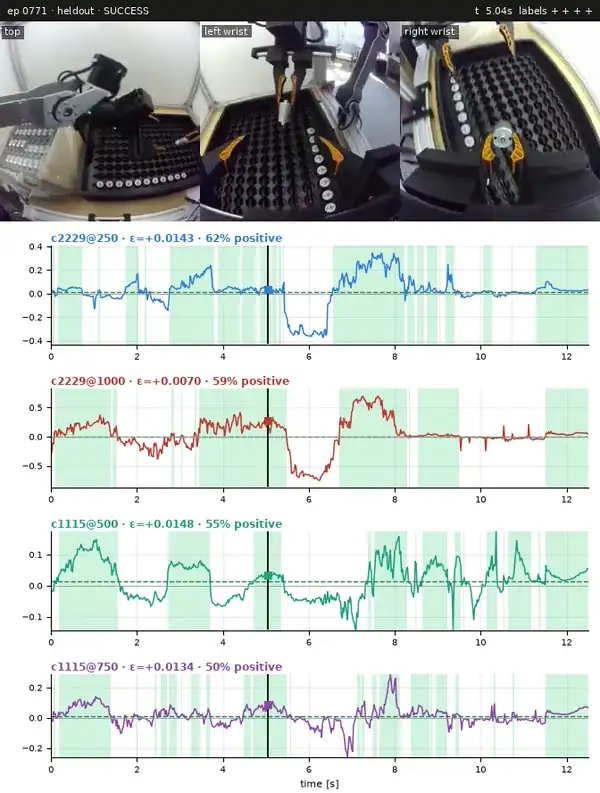

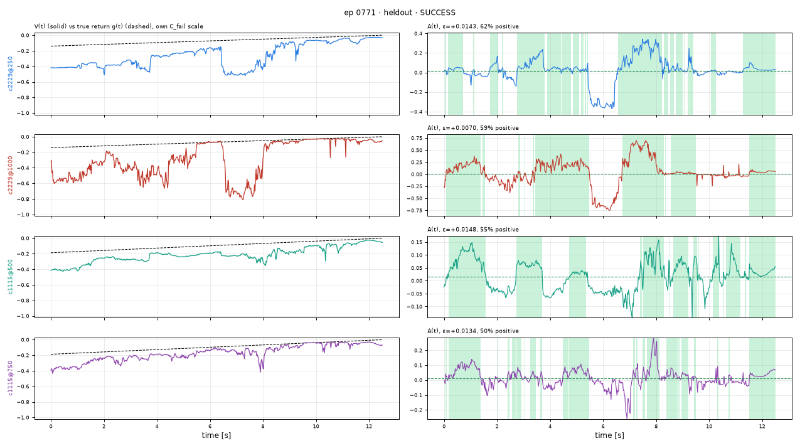

- **c2229 @ 250** dips to −0.5 at 6.5–8 s (A ≈ −0.35), then goes positive at the recovery. **c2229 @ 1000** dips
  even deeper, to −0.8.
- **c1115 @ 500 misses it.** Its V stays flat around −0.2 to −0.3, and its A only moves by about ±0.1. Its
  positive labels sit on stretches of steady progress instead: 0.2–1.5 s, 2.8–3.6 s, 4.7–5.3 s and 7.5–8.2 s.

[Full video](reports/figures/results/videos/critics_ep_0771_heldout.mp4)

#### Episode 707: held-out success with fumbles

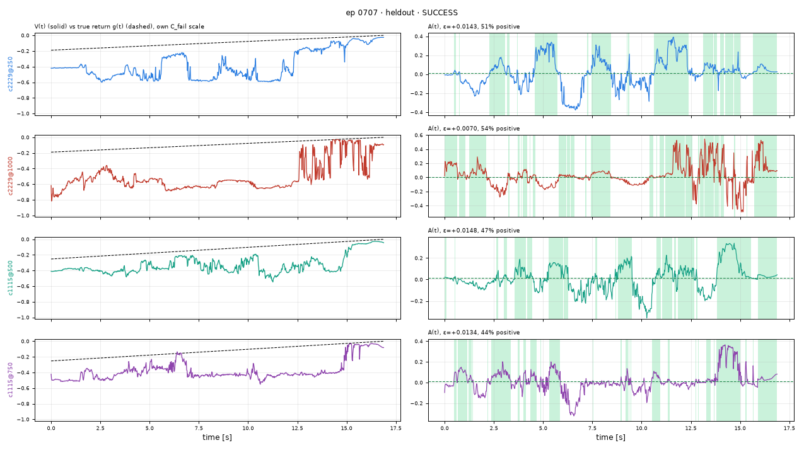

- **c2229 @ 250** has clear dips at ~3 s and at 6.5–7.2 s.
- **c1115 @ 500** reacts much less: its V stays between −0.5 and −0.2 throughout.
- **c2229 @ 1000** keeps V low (−0.6) for most of the episode, a successful one.

[Full video](reports/figures/results/videos/critics_ep_0707_heldout.mp4)

#### Episode 155: held-out failure, a mistake mid-episode and then ~18 s of struggling

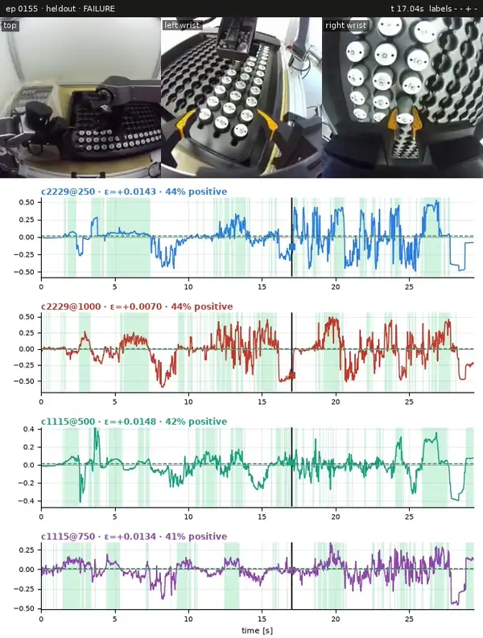

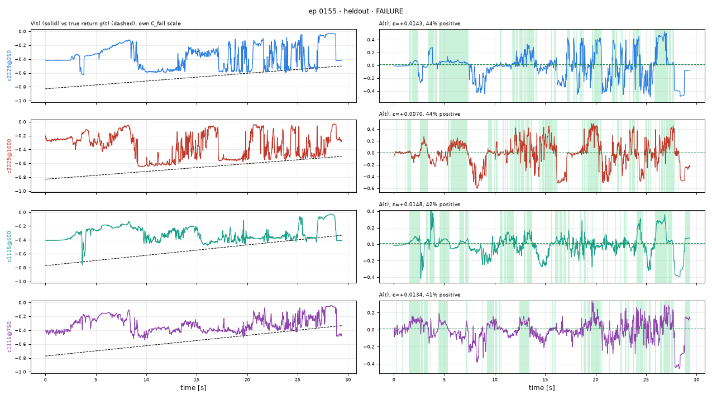

- **No critic handles this episode well.**
- **Both c2229 checkpoints** at least drop at ~9 s. **c1115 @ 500** has no clear drop there and stays around −0.4.
- **In the struggling phase** (clip: 17–25 s), every critic's V swings hard between "almost done" and "failing".
  41–44 % of the episode's frames end up positive, so post-mistake struggling gets labelled positive almost half
  the time.

[Full video](reports/figures/results/videos/critics_ep_0155_heldout.mp4)

#### Episode 364: training failure in which the policy tries to correct itself

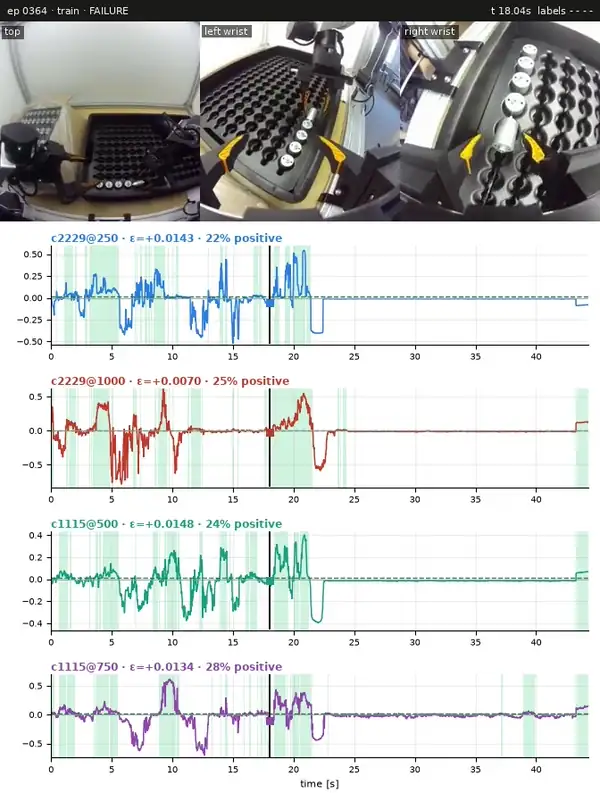

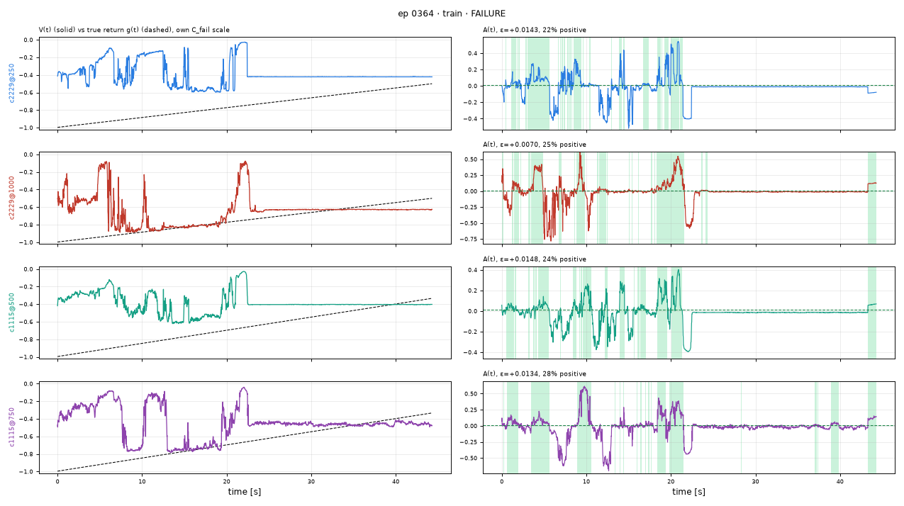

- **All critics show the same shape.** V oscillates, rises to almost 0 at ~21 s, then stays flat from 22 s to 44 s,
  where the scene is still (a human hand appears at ~23 s). 22–28 % of frames are positive.
- **This is structural.** The return target rates the attempted correction exactly as bad as the rest of a failed
  episode. C_fail only rescales that; it does not change it.

[Full video](reports/figures/results/videos/critics_ep_0364_train.mp4)

#### What the smaller penalty changes

- **What it gains.** c1115 does what a smaller penalty should: labels in successes follow speed and progress more,
  and it localises a single clear mistake well (episode 750).
- **What it costs.**
  - It reacts more weakly to temporary risk, such as the hidden bad moves in successes 771 and 707.
  - Because the penalty is smaller, a failure moves V less.
- **What it leaves unchanged.** The problems in §7 do not depend on C_fail.

## 7. What none of these critics can fix

These issues appear with every checkpoint and every penalty. They come from the Monte-Carlo target and from the
data, not from tuning.

1. **One outcome per episode.** Every frame of a failed episode carries the same "this failed" target. That
   includes the frames before the mistake and attempted corrections after it (episode 364). The critic separates
   them only by generalising across episodes, and on training episodes memorisation undoes that (§5.3).
2. **Post-mistake struggling looks like a coin flip.** Once something has gone wrong, V swings between "almost done"
   and "failing", so ~half of those frames are labelled positive (episode 155).
3. **No recoveries in the data.**
   - Failed episodes end where a human took over. That segment was cut from this export: the tray gains one
     actuator per episode even after failures, and failures end mid-motion.
   - RECAP would label human corrections positive, but we cannot see them.
   - The final penalty lands at the takeover, not at the mistake.

## 8. Next step: K-fold cross-fitting, then a single critic

*Proposed and specified ([method v2](docs/method_v2.md), steps 8–12 in [docs/steps/](docs/steps/)), not
implemented.*

The baseline is honest on episodes it never trained on and memorises the ones it did. So we make sure **no episode is
ever valued by a model that trained on it**. Then we distil the result into **one critic** with targets that no longer
contain the episode's outcome.

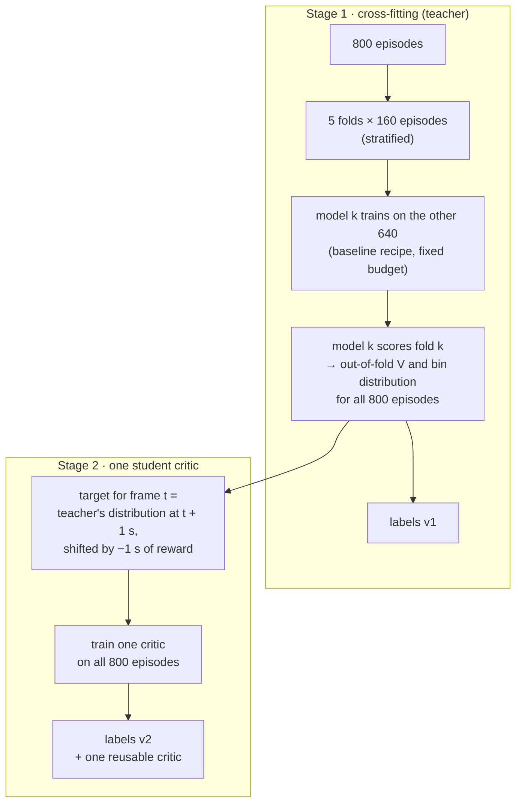

**Stage 1: cross-fitting.**
- Split the 800 episodes into 5 folds of 160.
- Fold model *k* trains with the baseline recipe on the other 640 episodes, then scores fold *k*.
- Every frame gets an **out-of-fold** value, i.e. held-out quality for all 800 episodes. This is RECAP's estimator
  unchanged; only who labels which episode changes.

**Stage 2: a single critic on bootstrapped targets.** Training five models leaves five critics. To get one critic,
train a student whose target for frame *t* is **what the teacher thinks one second later**, minus one second of
reward. This is a distributional 50-step TD target. Near the end of an episode, the true return is used instead.
- *Before a mistake* the target is high (the teacher still expects success one second later).
- *At the mistake* it drops.
- *During a recovered fumble* it is low, then rises.

These targets are functions of what the camera sees, not of the episode's secret outcome, so memorising them is
harmless. Their expected value is still the value of the data-collecting policy, the same quantity RECAP estimates.

**What it can and cannot do.**
- The student cannot know more than the teacher, so the held-out curves of §5 are roughly the ceiling.
- The expected gains:
  - held-out quality on the 85 % of frames that are training episodes;
  - smoother curves;
  - one critic to reuse on the next round of rollouts (averaging the 5 fold models is the alternative).
- It does **not** fix the post-mistake struggle or the missing recoveries (§7).

**Cost.** About 16–18 h of RTX 5090 time:
- 5 fold models with a budget of S = 500 steps: ~7 h;
- inference on all frames: ~3 h;
- the student: ≤ 5.5 h, plus ~3 h of inference.

**Sources.**
- The paper calls MC "less optimal than a more classic off-policy Q-function estimator", but "simple and highly
  reliable".
- [ROVE](https://arxiv.org/abs/2606.17011) pre-trains an MC critic, then fine-tunes it with TD.
- [ALOE](https://arxiv.org/abs/2602.12691) reports TD beating "MC returns as RECAP".
- The paper avoids memorisation with far more data plus web-data co-training. We have neither, so cross-fitting
  does that job.

## 9. Status, data asks and reproduction

### Status

| | |
|---|---|
| Pipeline (data → labels → videos) | ✅ built and tested; runs at full scale |
| Baseline critic + 2 variants | ✅ trained and analysed (§5, §6) |
| Labels on synthetic values | ✅ checked on all frames. A perfect V gives A ≡ 0, which is flagged as degenerate instead of being labelled from round-off. Pure noise gives coin-flip labels (mean run of 2 frames). An outcome-smoothed V collapses labels onto the outcome. The diagnostics catch all three. |
| **Labels for all 634 838 frames** | ⏳ **not produced yet**. Needs a choice of critic (c2229 @ 250, c1115 @ 500, or method v2), then ~3.5 h of inference (52 frames/s measured on the 5090) and 4 s of labelling |
| Method v2 (§8) | 📝 specified, not implemented |

### What better data would change

| Ask to DreamMachines | Why |
|---|---|
| The export **with interventions** | RECAP forces human-correction frames to positive. Failures would also end at a marked takeover. |
| **Failure timestamps** or quality ratings, even for a subset | They would replace eyeballing with a number ("does V drop within 1 s of the mistake?"). They would also allow putting the penalty at the mistake. |
| **More rollouts**, and the `actuator_unboxing_4h_diverse` demos | More episodes reduce memorisation. The demos match the paper's pre-training stage. |

### Reproduce

```bash
uv sync && uv run pytest -q
uv run python scripts/01_download.py && uv run python scripts/01_extract_frames.py --source local --episodes all
uv run python scripts/01_make_splits.py --seed 0 && uv run python scripts/02_compute_returns.py
uv run python scripts/04_train_value.py --config configs/train_default.yaml                       # baseline
uv run python scripts/04_train_value.py --config configs/train_default.yaml --run-name vf_c1115_s0 \
    --set returns_tag=c1115                                                                      # smaller penalty
uv run python scripts/04_train_value.py --config configs/train_default.yaml --run-name vf_c2229_frozen_s0 \
    --set model.freeze_vision=true model.freeze_language=true                                    # frozen backbones
uv run python scripts/06_infer_values.py --run vf_c2229_s0 --ckpt best                          # V for every frame
uv run python scripts/06_compute_advantages.py --run vf_c2229_s0 --segment-len 50               # A and labels
```

On the laptop, prefix the commands with `env -u PYTHONPATH`.

Checkpoints, metrics and full comparison videos are on the workstations:
- `curiosity:~/DreamMachines/runs/`: `vf_c2229_s0`, `vf_c1115_s0`, `ckpt_snapshots`, `viz_compare*`, `cmp_rows`;
- `dactyl:~/DreamMachines/runs/`: `vf_c2229_frozen_s0`.

The clips and plots on this page are in [reports/figures/results/](reports/figures/results/).

---

## 10. Human interventions: the DAgger dataset

*Added 2026-10-12. Code-level details: [docs/interventions.md](docs/interventions.md). Training outputs are in §10.5
(not analysed yet).*

### 10.1 The data

[`DreamMachines/actuator_unboxing_1h_HQ_dagger_rollouts`](https://huggingface.co/datasets/DreamMachines/actuator_unboxing_1h_HQ_dagger_rollouts)
is the data asked for in §9: rollouts where a human **takes over** whenever the policy gets into trouble, with every
takeover **marked frame by frame**.

| | |
|---|---|
| Task, robot, cameras, state | identical to the main dataset |
| Episodes | 240 (quality ratings 3–5), all of which end with the actuator in the tray |
| Frames | 256 537 at 50 fps (~1.4 h) |
| Human control | a per-frame `intervention` flag; 31 % of all frames |
| Takeovers | 285 in total: 28 episodes have none, 141 have one, 69 have two and 2 have three |
| Length of a takeover | 1.8–15 s, median 5.2 s |
| Where | at the grasp, at the handover and, most often, at the insertion (checked on the videos of episodes 3 and 111) |

There is no success column. Every episode ends under robot control with the task done, because the human steps in
until it is. **All episodes count as successes**; this is an explicit flag, not a silent default.

### 10.2 Reward shaping: a penalty before each takeover, cut at the next one

A takeover means *the robot needed help*. It plays the role that a failure plays in §3: what the critic must learn to
see coming.

```
r_t = −1                     every frame (robot or human)
r_t = −C_interv              on the robot's last frame before each takeover
r_last = 0                   the episode ends with the task done

G_t = sum of r from t up to the next takeover (included) — or to the end of the episode if no takeover follows
```

The return-to-go is **cut at the next takeover**. An episode thus splits into *stretches*. Each stretch is a human
correction followed by the robot's control, and it ends at the next takeover or at the end of the episode.

**Why the cut, rather than summing penalties to the end of the episode.**
1. **Blame stays local.** A second takeover is caused by what the robot did *after* the human handed back control, in
   a state the human had just repaired. Without the cut, every frame before the first takeover would also pay for
   the second one.
2. **Less noise.** Whether a later takeover happens is mostly unpredictable from the current frame. Counting it adds
   outcome noise to the targets, which §5.3 showed the network memorises.
3. **A usable value scale.** `Z` is the most negative return. With penalties piling up, two or three of them would set
   `Z` and squeeze every other target into a few of the 201 bins.
4. **Consistency with the main dataset.** There, failed episodes already end at the (cut) takeover with −C_fail.

**The penalty.** C_interv = **1060 frames**, the longest stretch that ends with the task done. This is the same rule
as C_fail = longest episode in §3.2: every frame that leads to a takeover scores below every frame that leads to the
end. With it, `Z = 839 − 1 + 1060 = 1898`:

| Situation | g |
|---|---|
| Last frame of an episode | 0 |
| Start of the slowest stretch that ends with the task done (1060 frames) | −0.558 |
| Robot's last frame before a takeover | −0.558 |
| Start of the longest stretch that ends in a takeover (839 frames) | −1.00 |

<p align="center">
  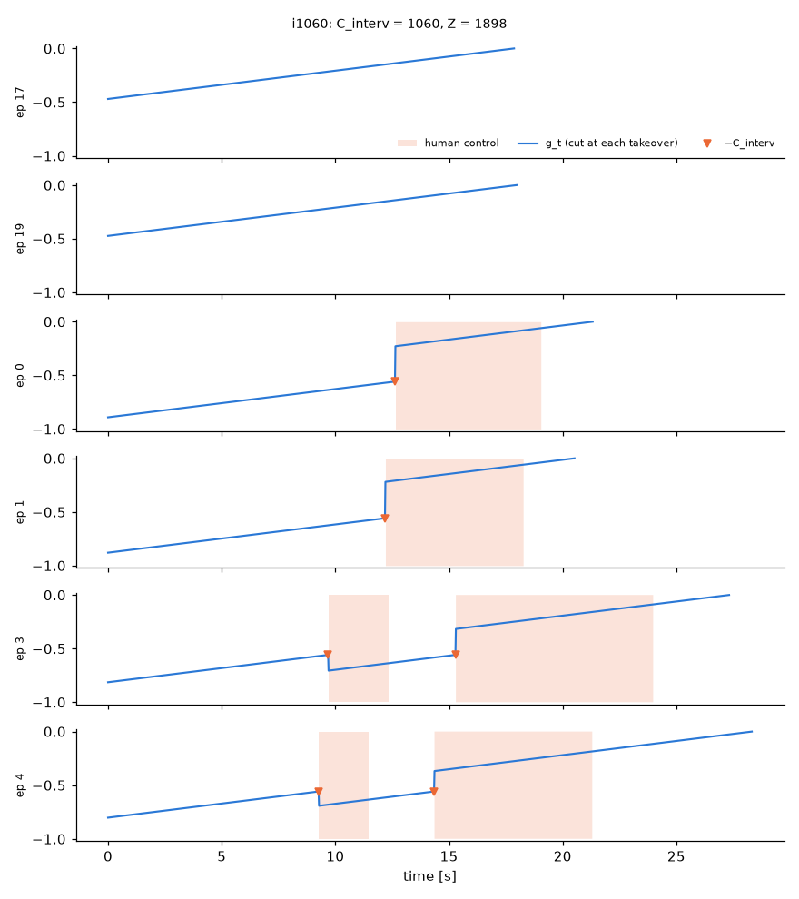
</p>

*g_t for episodes with 0, 1 and 2 takeovers. Orange: human control; triangles: the penalty frames. In episode 3,
frame 0 pays only for the first takeover. After the human hands back, a new stretch starts and pays only for the
second.*

**What V means here:** the expected time until the robot either finishes or needs help, with a large cost for
needing help. That is the quantity we want for judging the robot's actions. What V no longer measures is how many
takeovers remain in the episode.

### 10.3 From values to labels

```
A_t = (reward over the next N frames, stopping at the cut) + V(o_{t+N}) [only if t+N is before the cut] − V(o_t)
I_t = A_t ≥ ε  on robot frames (ε → 40 % of robot frames positive);   I_t = True on human frames
```

- **The one-second window stops at the cut.** A window that reaches the next takeover sums the rewards up to it,
  including −C_interv, and adds no value after it, exactly as at the end of an episode.
  - If it crossed the cut, it would add V of a frame after the human's repair. That value is high and would cancel
    the penalty.
  - A unit test checks that a perfect V gives A = 0 on every frame, including at the cuts.
- **Human frames are labelled positive.** This is RECAP's rule for corrections. The threshold is computed on the
  robot's frames only.
- **What the labels should say:**
  - robot actions in the seconds before a takeover: negative (V falls towards −0.558, or the penalty falls inside
    the window);
  - progress after a handback: positive;
  - the human correction itself: positive.

This also addresses two items of §7:
- **Recoveries are now in the data, and labelled positive.**
- **The penalty lands at the takeover.** The time between the mistake and the operator's reaction remains, but it is
  short here: the takeover is the operator's reaction itself, not the end of a long failed attempt.

### 10.4 What changed in the pipeline

| Change | Why |
|---|---|
| `RECAP_DATASET` switch (`constants.DATASETS`); this dataset lives in `data/raw/<name>/` and `data/cache/<name>/` | Run the same code on both datasets; the main dataset's layout is unchanged (its returns and splits are reproduced bit for bit) |
| Frame extraction handles **one mp4 per episode** | This export stores each episode in its own file. 240 episodes / 256 537 frames frame-exact, 15 GB, extracted in 50 s |
| Splits stratified on **number of takeovers (0 / 1 / 2+) × length** | Every episode succeeds, so stratifying on success does nothing. 204 train / 36 held-out, plus 5 folds |
| Returns with the cut (`returns_i1060`), advantage window stopping at the cut, human frames forced positive | §10.2–10.3 |
| `configs/train_dagger.yaml` refuses to run on the wrong dataset; `scripts/run_dagger_pipeline.sh` runs everything, resumably | Safety and one-command reproduction |

111 unit tests pass, including tests for the cut, the penalties counted once each, the window stopping at the cut,
one mp4 per episode and the new stratification.

### 10.5 Training `vf_dagger_i1060_s0`

*Trained on the RTX 5090 from 18:35. The plots and videos below are raw outputs of this run: **we have not analysed
them yet**, so no conclusions are drawn here.*

- **Recipe:** the baseline's, unchanged (§4). It uses the same backbone and the 201 bins; the only change is the
  targets of §10.2.
- **Budget:** a cap of 850 steps ≈ one pass over the 218 k training frames, the same rule as the baseline. Evals at
  250, 500, 750 and 850, with early stopping and the best checkpoint chosen on held-out cross-entropy.
- **Then:** V for every frame (best checkpoint), then the labels of §10.3.
- **Smoke test on the 5090:** 31 samples/s, peak memory 13.7 GiB, loss falling. The success AUC and failure-detection
  metrics are undefined here (no failures).

**V(t) on 6 held-out and 6 training episodes** (2 each with 0, 1 and 2+ takeovers), checkpoint step 250. Dashed:
target g(t); orange shading: human control; red triangles: takeover penalties.

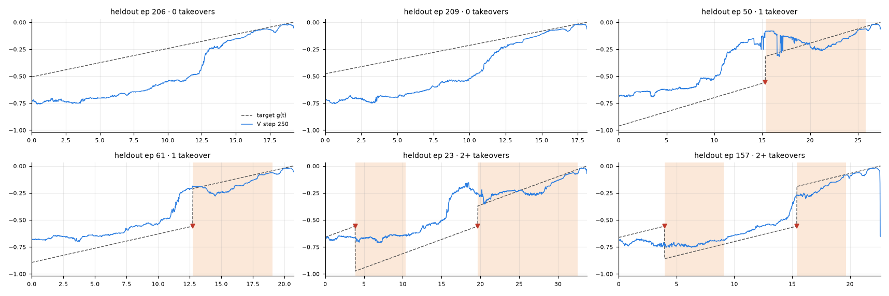
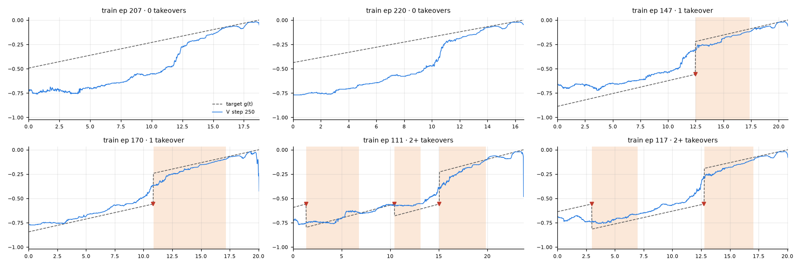

**Videos**: the 3 cameras with V(t) underneath and a moving cursor; the header says when the human is in control.
They are WebM (VP9) and local only, in `runs/viz_dagger/` (git-ignored); the `.mp4` next to each is the same video in
H.264.

| | 0 takeovers | 1 takeover | 2+ takeovers |
|---|---|---|---|
| held-out | [206](runs/viz_dagger/heldout/ep_0206.webm) · [209](runs/viz_dagger/heldout/ep_0209.webm) | [50](runs/viz_dagger/heldout/ep_0050.webm) · [61](runs/viz_dagger/heldout/ep_0061.webm) | [23](runs/viz_dagger/heldout/ep_0023.webm) · [157](runs/viz_dagger/heldout/ep_0157.webm) |
| train | [207](runs/viz_dagger/train/ep_0207.webm) · [220](runs/viz_dagger/train/ep_0220.webm) | [147](runs/viz_dagger/train/ep_0147.webm) · [170](runs/viz_dagger/train/ep_0170.webm) | [111](runs/viz_dagger/train/ep_0111.webm) · [117](runs/viz_dagger/train/ep_0117.webm) |

Only step 250 is shown. Steps 500, 750 and 850 are rendered on the workstation
(`curiosity:~/DreamMachines/runs/viz_dagger/`) and will replace these once copied over. Re-render with
`scripts/07_compare_checkpoints.py`.

### 10.6 Open points

- **The first moments of human control.** The operator hesitates and re-aligns before correcting, and these frames
  are labelled positive with the rest of the takeover.
  - [ROVE](https://arxiv.org/abs/2606.17011) puts its penalty at the end of this phase instead.
  - Its evidence for that is not clean: the ablation also changes the critic's horizon.
- **Memorisation (§5.3) applies here too.** We label the episodes we train on, and there are only 204 of them.
  Cross-fitting (§8) would apply unchanged.
- **The all-success assumption** relies on every episode ending under robot control with the task done, plus two
  episodes checked on video.

### 10.7 Reproduce

```bash
bash scripts/run_dagger_pipeline.sh          # on the workstation: download → frames → splits → returns → train → V → labels
# or step by step, with RECAP_DATASET=actuator_unboxing_1h_HQ_dagger_rollouts:
uv run python scripts/01_download.py && uv run python scripts/01_extract_frames.py --source local --episodes all
uv run python scripts/01_make_splits.py --stratify interventions
uv run python scripts/02_compute_intervention_returns.py
uv run python scripts/04_train_value.py --config configs/train_dagger.yaml
uv run python scripts/06_infer_values.py --run vf_dagger_i1060_s0 --ckpt best
uv run python scripts/06_compute_advantages.py --run vf_dagger_i1060_s0 --returns-tag i1060 --segment-len 50
```
